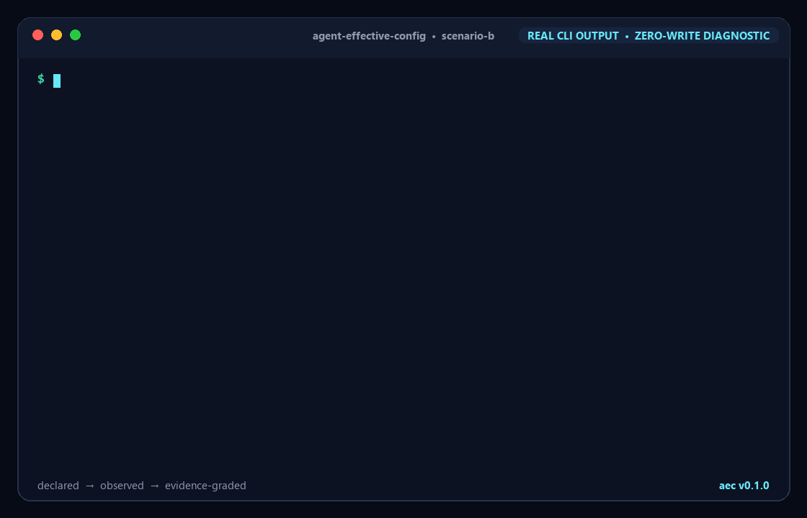
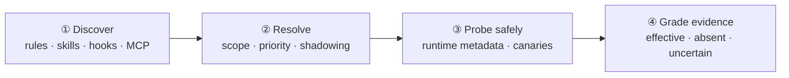

<p align="center">
  
</p>

<h1 align="center">Agent Effective Config <code>aec</code></h1>

<p align="center">
  <strong>Know what your AI coding agent actually loaded.</strong><br />
  Probe-first diagnostics for rules, skills, permissions, hooks, and MCP servers across Claude Code, Codex, and Cursor.
</p>

<p align="center">
  <a href="LICENSE"></a>
  <a href="package.json"></a>
  <a href="test/aec.test.js"></a>
  <a href="plugin.json"></a>
  
</p>

<p align="center">
  <a href="#demo">Demo</a> ·
  <a href="#quick-start">Quick start</a> ·
  <a href="#agent-plugin">Agent plugin</a> ·
  <a href="#core-features">Features</a> ·
  <a href="#evidence-levels">Evidence model</a> ·
  <a href="#tested-agents">Agent support</a>
</p>

---

<a id="demo"></a>

## 🎬 Demo

<p align="center">
  
</p>

Run `aec` against the Codex fixture and it separates declarations from observations: `AGENTS.override.md` replaces `AGENTS.md`, an MCP executable is missing, and operation-specific permissions and hooks remain explicitly unverified. Every conclusion includes its evidence and the limit of what was observed.

> [!TIP]
> `test/fixtures/scenario-b` is intentionally misconfigured so a fresh clone produces useful findings immediately—without changing your machine or repository.

## 💡 Why this exists

Static scanners can prove that a configuration file exists. They cannot prove that an agent loaded it, that a higher-priority source did not replace it, or that a hook and MCP server were present at runtime. `aec` closes that gap without pretending uncertain evidence is certain.

| Question | What `aec` reports |
|---|---|
| **What was declared?** | Every recognized configuration source and its priority. |
| **What was observable?** | Safe runtime receipts, canary results, parse failures, and missing executables. |
| **What can be concluded?** | One of four evidence levels, with a reason and explicit limitation. |

<a id="quick-start"></a>

## 🚀 Quick start

```sh
git clone https://github.com/LiChang1125/agent-effective-config.git
cd agent-effective-config
AEC_INSTALL_DIR="$PWD/.local/bin" ./bin/install.sh
./.local/bin/aec --cwd test/fixtures/scenario-b --agent codex
./.local/bin/aec --cwd test/fixtures/scenario-b --agent codex --json
```

Node.js 18 or newer is required. macOS and Linux are supported; native Windows through Git Bash is currently experimental. The installer writes only to `AEC_INSTALL_DIR`; without it, the script clearly announces and uses `$HOME/.local/bin`.

<details>
<summary><strong>CLI options</strong></summary>

| Option | Purpose |
|---|---|
| `--cwd <directory>` | Diagnose a specific working directory. |
| `--agent <name>` | Select `claude-code`, `codex`, or `cursor`; otherwise auto-detect. |
| `--probe` | Run supported read-only runtime probes and embedded canaries. |
| `--json` | Emit the stable machine-readable report contract. |
| `--no-color` | Disable ANSI terminal colors. |

</details>

<a id="agent-plugin"></a>

## 🧸 Use it as an agent plugin

The repository is also a portable Agent Plugin. One `aec-diagnose` skill powers all three supported hosts, so the evidence model and CLI cannot drift between editors.

| Host | Install or load | Invoke |
|---|---|---|
| **Codex** | `codex plugin marketplace add LiChang1125/agent-effective-config`, then `codex plugin add agent-effective-config@agent-effective-config` | Start a new chat and ask: `Use $aec-diagnose to inspect this project.` |
| **Claude Code** | From the cloned repository, run `claude --plugin-dir .` | Run `/agent-effective-config:aec-diagnose` |
| **Cursor** | Copy the repository to `~/.cursor/plugins/local/agent-effective-config`, then reload Cursor | Run `/aec-diagnose` in Agent chat |

The skill starts with a read-only JSON diagnosis. It adds live `--probe` checks only when requested, and it never rewrites project configuration on its own.

<a id="core-features"></a>

## ✨ Core features

| | Capability | Why it matters |
|---|---|---|
| 🗂️ | **Configuration discovery and precedence** | Finds recognized sources from the repository root to the requested directory and explains which source wins. |
| 🔬 | **Zero-write probes** | Uses read-only agent modes and traceable canaries where the vendor exposes enough evidence. |
| 🧩 | **Four evidence levels** | Keeps “not followed” separate from “not loaded,” so a probabilistic model miss never becomes a false certainty. |
| 📦 | **Human and machine output** | Renders a status-grouped terminal report by default and a stable JSON contract for CI with `--json`. |

### How it works



The adapter boundary keeps vendor-specific discovery and probing replaceable while the report contract stays stable.

## ⚖️ How this differs

| Approach | What it proves | What it cannot prove |
|---|---|---|
| Static config scanner | A declaration exists and parses. | Runtime visibility or model adherence. |
| Harness compiler | The harness assembled a prompt and tool set. | What another vendor's installed agent actually loaded. |
| **`aec`** | Precedence plus traceable runtime or negative evidence when available. | Unobservable behavior; it reports this honestly as `UNVERIFIED`. |

<a id="evidence-levels"></a>

## 🚦 Evidence levels

| Status | Meaning | Limitation |
|---|---|---|
| 🟢 `CONFIRMED_EFFECTIVE` | A traceable canary or runtime listing matched the source. | Applies to the observed run and adapter version, not every future prompt. |
| 🔴 `CONFIRMED_NOT_LOADED` | A deterministic path, parse, precedence, missing-executable, or runtime probe proved invisibility. | Does not say whether the declaration itself is desirable. |
| 🟠 `LOADED_BUT_UNFOLLOWED` | Visibility was independently confirmed, but the sampled response missed the canary. | Model behavior is probabilistic; repeat samples before concluding. |
| ⚪ `UNVERIFIED` | The declaration was found, but no safe zero-write observation could prove its state. | Absence of evidence is not evidence of absence. |

> [!IMPORTANT]
> **Not followed does not mean not loaded.** `aec` only emits `LOADED_BUT_UNFOLLOWED` when visibility is known independently. A canary miss without separate visibility evidence remains `UNVERIFIED`.

Add a marker such as `AEC_CANARY: TEAM_RULE_7F3K` to an existing instruction source, then run `aec --probe`. The marker stays in your configuration; `aec` does not inject or rewrite it.

<a id="tested-agents"></a>

## 🤖 Tested agents and adapter coverage

| Agent | Tested profile | Confirmable today | Conservatively unverified |
|---|---|---|---|
| 🟠 **Claude Code** | Official configuration profile checked 2026-10-20; live binary unavailable on the release machine. | Unsupported `AGENTS.md`, invalid JSON, precedence, missing MCP executable; live MCP and canary checks when installed. | Permissions and hooks that require a real operation. |
| 🟢 **Codex** | `codex-cli 0.163.0-alpha.10.2`; plugin install and `$aec-diagnose` invocation passed on 2026-10-21. | `AGENTS.override.md` precedence, unreadable config, missing MCP executable, live MCP and canary checks. | Operation-specific permissions and hooks without receipts. |
| 🟠 **Cursor Agent** | Official configuration profile checked 2026-10-20; live binary unavailable on the release machine. | Invalid JSON, missing MCP executable, and live MCP listing when installed. | Instruction adherence, skills, permissions, and hook firing. |

Adapters implement the same `discoverConfigs`, `probeVisibility`, and `runCanary` contract in [`src/adapters/`](src/adapters/). Their tested profile lives beside each implementation so vendor-specific behavior can evolve without changing the output schema.

## ❓ FAQ

<details>
<summary><strong>Why can a canary be wrong?</strong></summary>

A model may ignore an instruction it did receive. A token miss without separate visibility evidence remains `UNVERIFIED`; only independently visible-but-missed sources become `LOADED_BUT_UNFOLLOWED`.

</details>

<details>
<summary><strong>Which settings can only be UNVERIFIED?</strong></summary>

Permissions tied to a particular tool call, hooks that require a specific lifecycle event, and agent features without a read-only inspection endpoint stay unverified until that exact behavior can be observed safely.

</details>

<details>
<summary><strong>How do I add another agent?</strong></summary>

Implement the contract in [`src/adapters/contract.js`](src/adapters/contract.js), keep discovery and probing vendor-specific, register the adapter in [`src/adapters/index.js`](src/adapters/index.js), and add fixtures for precedence, runtime absence, and canary classification.

</details>

## ⭐ Star history

[](https://www.star-history.com/#LiChang1125/agent-effective-config&Date)

## 📄 License

Released under the [MIT License](LICENSE).

<p align="center">
  Built for developers who switch agents without lowering their evidence standards.<br />
  <a href="https://github.com/LiChang1125/agent-effective-config/issues">Report an issue</a> ·
  <a href="https://github.com/LiChang1125/agent-effective-config/discussions">Start a discussion</a>
</p>
