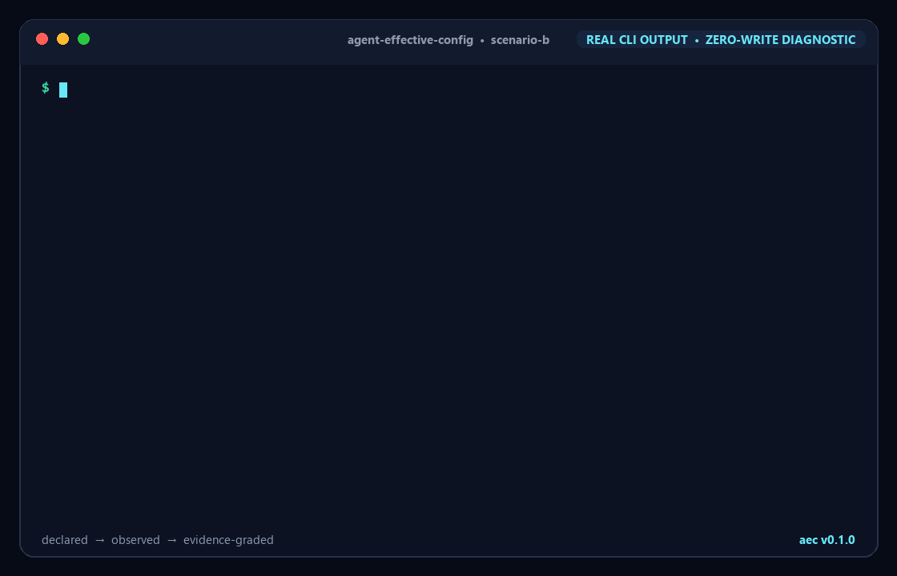

# Agent Effective Config (`aec`)

**Probe-first diagnostics for the rules, skills, permissions, hooks, and MCP servers that an AI coding agent can actually use.**

## Demo



Run `aec` against the Codex fixture and it separates declarations from observations: `AGENTS.override.md` replaces `AGENTS.md`, an MCP executable is missing, and operation-specific permissions and hooks remain explicitly unverified. Each conclusion includes the evidence and the limit of what was observed.

## Why this exists

Static scanners can show that a config file exists, but not whether an agent loaded it, whether a higher-priority source replaced it, or whether a hook ever registered. That gap turns regressions after agent upgrades and “works on my machine” rule failures into guesswork. `aec` reports only what its evidence can support.

## Quick start

From the repository root:

```sh
AEC_INSTALL_DIR="$PWD/.local/bin" ./install.sh
export PATH="$PWD/.local/bin:$PATH"
aec --cwd fixtures/scenario-b
aec --cwd fixtures/scenario-b --json
```

Node.js 18 or newer is required. macOS and Linux are supported; native Windows via Git Bash is currently experimental. The installer writes only to `AEC_INSTALL_DIR`; without that variable it clearly announces and uses `$HOME/.local/bin`.

## Core features

- Discovers agent configuration and computes source precedence from the repository root to the requested directory.
- Runs opt-in, zero-repository-write canaries with `--probe`; temporary or live operations use read-only agent modes where available.
- Keeps every result in one of four evidence levels and never turns an ordinary model miss into “not loaded.”
- Emits a stable JSON contract with `--json` and a status-grouped, highlighted terminal report by default.

## How this differs

| Approach | What it proves | What it cannot prove |
|---|---|---|
| Static config scanner | A declaration exists and parses | Runtime visibility or model adherence |
| Harness compiler | The harness assembled a prompt/tool set | What another vendor's installed agent actually loaded |
| `aec` | Precedence plus traceable runtime/negative evidence when available | Unobservable behavior; it reports this as `UNVERIFIED` |

## Evidence levels

| Status | Meaning | Limitation |
|---|---|---|
| `CONFIRMED_EFFECTIVE` | A traceable canary or runtime listing matched the source. | Applies to the observed run and adapter version, not all future prompts. |
| `CONFIRMED_NOT_LOADED` | A deterministic path, parse, precedence, missing-executable, or runtime probe proved invisibility. | Does not say whether the declaration itself is desirable. |
| `LOADED_BUT_UNFOLLOWED` | Visibility was independently confirmed, but the sampled response missed the canary. | Model behavior is probabilistic; repeat samples before concluding. |
| `UNVERIFIED` | The declaration was found but no safe zero-write observation could prove its state. | Absence of evidence is not evidence of absence. |

**Not followed does not mean not loaded.** `aec` only emits `LOADED_BUT_UNFOLLOWED` when visibility is known independently. Add a config line such as `AEC_CANARY: TEAM_RULE_7F3K`, then use `aec --probe`; the marker stays in your config and `aec` does not inject or rewrite it.

## Tested agents and adapter versioning

| Adapter | Tested profile | Confirmable now | Conservatively unverified |
|---|---|---|---|
| Claude Code | Official config profile checked 2026-10-20; live binary not present on the release machine | Unsupported `AGENTS.md`, invalid JSON, precedence, missing MCP executable; live MCP/canary when CLI is installed | Permissions and hooks that require a real operation |
| Codex | `codex-cli 0.163.0-alpha.10.2` plus official config profile checked 2026-10-20 | `AGENTS.override.md` precedence, unreadable config, missing MCP executable; live MCP/canary | Operation-specific permissions and hooks without receipts |
| Cursor Agent | Official config profile checked 2026-10-20; live binary not present on the release machine | Invalid JSON and missing MCP executable; live MCP listing when CLI is installed | Instruction adherence, skills, permissions, and hook firing |

Adapters implement the same `discoverConfigs`, `probeVisibility`, and `runCanary` contract in `adapters/`. Their tested profile is kept beside the implementation so vendor-specific parsing can change without changing the report contract. Config locations follow the vendors' current documentation for [Claude Code memory](https://docs.anthropic.com/en/docs/claude-code/memory), [Codex `AGENTS.md`](https://developers.openai.com/cookbook/examples/gpt-5/codex_prompting_guide), and [Cursor rules](https://docs.cursor.com/context/rules).

## FAQ

### Why can a canary be wrong?

A model may ignore an instruction it did receive. A token miss without separate visibility evidence remains `UNVERIFIED`; only independently visible-but-missed sources become `LOADED_BUT_UNFOLLOWED`.

### Which settings can only be `UNVERIFIED`?

Permissions tied to a particular tool call, hooks that require a specific lifecycle event, and agent features without a read-only inspection endpoint stay unverified until that exact behavior can be observed safely.

### How do I add another agent?

Implement the contract in `adapters/contract.js`, keep discovery and probing vendor-specific, register the adapter in `adapters/index.js`, and add fixtures for precedence, runtime absence, and canary classification.

## Star History

<!-- Replace OWNER/REPO after publishing. -->

`https://star-history.com/#OWNER/agent-effective-config&Date`

## License

MIT — see [LICENSE](LICENSE).
